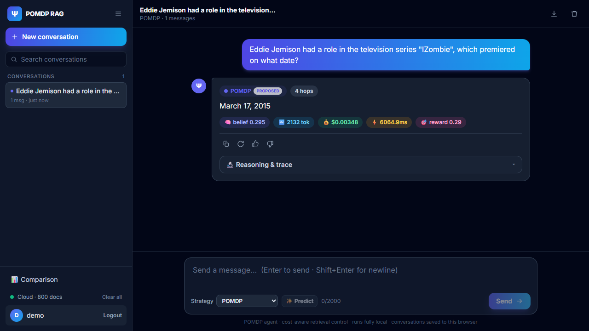
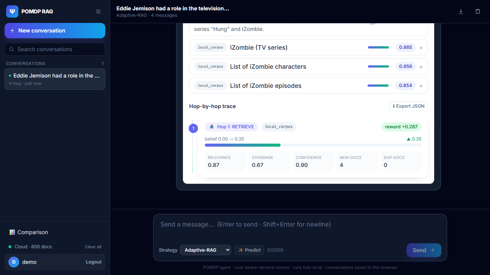

# Live AWS end-to-end evidence

Date: 2026-11-08. Region: ap-southeast-2 (Sydney), account 535635599719.
Everything below was run against **live AWS services**, not local mocks.

## What ran on live AWS
| Component | Service / model |
|---|---|
| LLM (answers, judge, follow-up queries, router) | Amazon Bedrock, Claude Haiku 4.5 (`au.anthropic.claude-haiku-4-5-20251001-v1:0`) |
| Embeddings | Amazon Bedrock, Titan Text Embeddings v2 (256 dimensions) |
| Vector retrieval | Amazon OpenSearch Service, kNN index `hp-test` (800 passages) |
| Controller | FastAPI backend (this repo), run locally, calling the services above |
| UI | React frontend, driven in Microsoft Edge by Playwright |

Not exercised by this test: DynamoDB, S3 and Cognito are provisioned, but sign-in uses
the `DEMO_LOGIN` switch (local password), and no Lambda/ECS deployment exists.

## Tests
- `scripts/live_e2e_api.py`: 6 questions x 4 strategies through the real API.
- `frontend/e2e/live.spec.ts`: Playwright UI test (sign-in, each strategy, trace, dashboard).

Result: **API test PASS (0 failed checks), UI test PASS.** Raw API report:
[live_e2e_report.json](./live_e2e_report.json).

Checks per call: the backend reports cloud mode and a non-empty index; sign-in returns a
token; every response has real Bedrock tokens and a non-zero cost, a trace, and retrieved
documents; two answers with known gold values were correct (March 17, 2015; Queens); the
question that is not in the index ended as "Insufficient evidence." with low belief.
Total spend for the API run: about $0.067.

## Results by question (live API run)
Hops, final belief, USD per query. All four strategies returned the same answer on every
in-index question.

| Question | POMDP | Fixed | Self-RAG | Adaptive-RAG | Answer |
|---|---|---|---|---|---|
| Eddie Jemison, IZombie premiere | 4 hops, 0.29, $0.00347 | 3, 0.32, $0.00263 | 6, 0.00, $0.00315 | 1, 0.35, $0.00108 | March 17, 2015 |
| Pharaohe Monch hometown | 3, 0.47, $0.00347 | 3, 0.57, $0.00380 | 2, 0.72, $0.00218 | 3, 0.46, $0.00367 | Queens, New York |
| Hot Rod / Memory of Our People magazines | 2, 0.49, $0.00278 | 3, 0.48, $0.00366 | 2, 0.70, $0.00161 | 3, 0.48, $0.00392 | Yes |
| The Last Lions vs Prophet's Prey | 2, 0.51, $0.00246 | 3, 0.51, $0.00361 | 2, 0.71, $0.00193 | 1, 0.35, $0.00137 | The Last Lions |
| Founder of the 1988 Orchestra | 2, 0.44, $0.00216 | 3, 0.42, $0.00311 | 2, 0.64, $0.00159 | 3, 0.42, $0.00322 | Dutch |
| Photosynthesis (not in index) | 4, 0.24, $0.00400 | 3, 0.26, $0.00309 | 6, 0.00, $0.00381 | 1, 0.21, $0.00129 | Insufficient evidence. |

Average over the five in-index questions:

| Strategy | Hops | USD/query | Tokens |
|---|---|---|---|
| POMDP | 2.60 | 0.00287 | 1,951 |
| Fixed | 3.00 | 0.00336 | 2,266 |
| Self-RAG | 2.80 | 0.00209 | 1,498 |
| Adaptive-RAG | 2.20 | 0.00265 | 1,805 |

**Read this as a smoke test, not a benchmark.** Five questions cannot rank strategies; here
Self-RAG happened to be the cheapest. The statistically tested comparison (n=80 per
dataset, paired bootstrap CIs, ablation) is in [../RESULTS.md](../RESULTS.md).

## Observed behaviour worth knowing
- On a question that is not in the index, the POMDP spent 4 hops (about $0.004) before
  answering "Insufficient evidence."; Self-RAG ran to the 6-hop cap. The system does not
  invent an answer, but it does not stop early on hopeless queries either.
- The UI reproduces the API numbers for the same question (POMDP, 4 hops, $0.0035).
  The UI session used default token prices (0.003 / 0.015 USD per 1K) rather than the
  Haiku prices (0.001 / 0.005) used in the benchmarks; the launcher
  `scripts/start_live_ui.ps1` now sets the Haiku prices.

## Screenshots (live UI)
Each shows the footer badge "Cloud - 800 docs" (live index).

| # | File | Shows |
|---|---|---|
| 1 | [01-pomdp.png](./screenshots/01-pomdp.png) | POMDP answer: 4 hops, belief 0.295, 2,132 tokens, $0.00348 |
| 2 | [02-fixed-rag.png](./screenshots/02-fixed-rag.png) | Fixed RAG on the same question |
| 3 | [03-self-rag.png](./screenshots/03-self-rag.png) | Self-RAG on the same question |
| 4 | [04-adaptive-rag.png](./screenshots/04-adaptive-rag.png) | Adaptive-RAG on the same question |
| 5 | [05-reasoning-trace.png](./screenshots/05-reasoning-trace.png) | Reasoning and trace: retrieved passages with scores, hop-by-hop belief |
| 6 | [06-pomdp.png](./screenshots/06-pomdp.png) | POMDP on the out-of-index question |
| 7 | [07-comparison-dashboard.png](./screenshots/07-comparison-dashboard.png) | Comparison dashboard, "Cloud mode - online" |

## AWS console screenshots
Taken in the AWS console, region Asia Pacific (Sydney), 2026-11-08.

| File | Shows |
|---|---|
| [01-opensearch-domain-list.png](./aws-console/01-opensearch-domain-list.png) | OpenSearch Service dashboard: one domain (`agentic-rag-vectors`), status Active, engine OpenSearch 2.11, cluster health **Yellow**, 7.68 GiB free storage. This is the domain list, not the domain detail page, so the endpoint, instance type and document count are not visible. |
| [02-cloudwatch-bedrock-metrics.png](./aws-console/02-cloudwatch-bedrock-metrics.png) | CloudWatch metrics for Bedrock: metrics exist for `amazon.titan-embed-text-v2:0` and `au.anthropic.claude-haiku-4-5-20251001-v1:0` (Invocations, InputTokenCount, InvocationLatency), showing both models were actually invoked in this account and region. No metric is selected, so the graph is empty. |

| [03-cli-domain-and-indexes.png](./aws-console/03-cli-domain-and-indexes.png) | CloudShell (account 535635599719): domain `agentic-rag-vectors`, OpenSearch 2.11, `t3.small.search`, 1 node, Processing False, endpoint in ap-southeast-2; signed-request document counts per index: `hp-val` 300, `hp-test` 800, `hp-t200` 1,996, `ms-val` 165, `ms-test` 651, `ms-study` 186, plus earlier experiment indexes (`hotpot-*`) and a 12-document smoke-test index. |
| [04-cli-bedrock-and-invocations.png](./aws-console/04-cli-bedrock-and-invocations.png) | Bedrock inference profile "AU Anthropic Claude Haiku 4.5" ACTIVE and Titan Text Embeddings v2 (provider Amazon); CloudWatch `AWS/Bedrock` Invocations for the Haiku 4.5 profile: 14,838 in the 24 hours ending 2026-11-09 08:03 UTC (10 the day before). The window is the last 3 days only, so it is a partial total. |
| [05-cli-services-and-results.png](./aws-console/05-cli-services-and-results.png) | DynamoDB table `agentic-rag-state` ACTIVE (pay-per-request), Cognito pool `agentic-rag-users` (its `Status` field prints `None`, which is normal for that API), S3 bucket with only a `smoke.txt` object (the benchmarks did not write to S3); result folders `hpv2`, `hpv4`, `msv2`; per-query row counts 321 (80 queries x 4 strategies + header) and 601 (200 x 3 + header). |

Not captured: the OpenSearch domain detail page in the console and a CloudWatch graph with a
metric selected. A Bedrock model-catalog page for "Claude Haiku 5.5" was also seen, but the
experiments used Claude Haiku 4.5, so it is not used as evidence.

## Reproduce
1. In CloudShell: `aws configure export-credentials --format powershell`, copy the 3 lines.
2. `powershell -ExecutionPolicy Bypass -File .\scripts\start_live_ui.ps1` (reads the clipboard).
3. `python scripts/live_e2e_api.py` and, from `frontend`,
   `E2E_NO_SERVER=1 E2E_CHANNEL=msedge E2E_PASSWORD=<printed password> E2E_SHOTS_DIR=<dir> npx playwright test live`.

Temporary keys last only about 10 minutes; rerun step 1 and 2 if calls fail with `ExpiredToken`.
